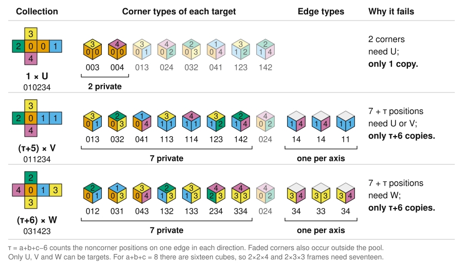
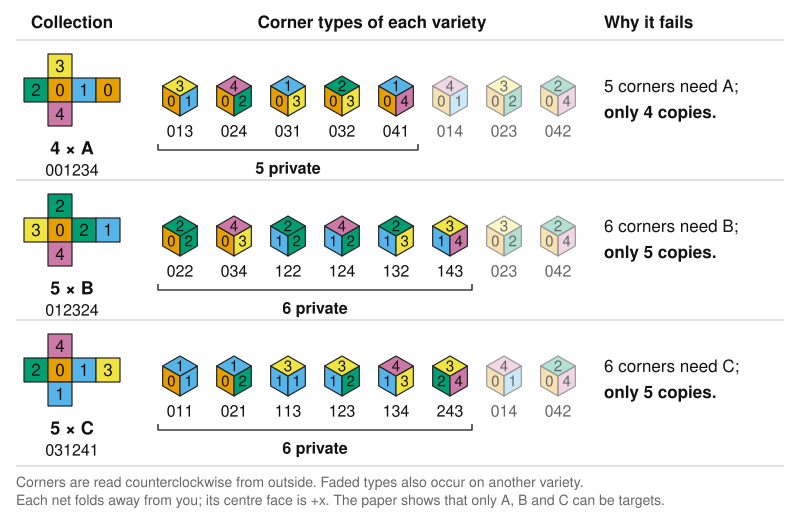

# Sharp thresholds for five-colour cube assemblies

- [Paper (PDF)](paper/five-colour-cubes.pdf) and [LaTeX](paper/five-colour-cubes.tex).
- [Physical target statements](FiveColour/Problem.lean), [fourteen-cube lower bound](FiveColour/LowerBound.lean), and [formalisation guide](FiveColour/README.md).
- [Interval checker](FiveColour/BoxCertificates.lean), [packed checker](FiveColour/PackedVerified.lean), and [chunk composition](FiveColour/PackedChunks.lean).
- [Provenance and verification scope](formalization.yaml).

**Every collection of fifteen cubes using all five fixed face colours contains
eight that build a five-colour target. Fourteen need not suffice.** The target
is a 2×2×2 cube with monochromatic exterior faces using all five colours.
Collections may repeat varieties; proper rotations are allowed and interior
faces are unrestricted.

**Every cuboid threshold is now determined**, for side lengths a, b, c ≥ 2:

- **F₅(a,b,c) = max(15, 4(a+b+c) − 16, 2(a+b+c) + 1)** for frames.
- **G₅(a,b,c) = max(abc, 15, 2(a+b+c) + 1)** for complete boxes.

The frame threshold depends only on the sum of the side lengths. It is 15
for sums 6 and 7, 17 for sum 8, and the frame's own position count for sums
at least 9. In particular, both sixteen-position frames, 2×2×4 and 2×3×3,
need one spare source. A single three-variety obstruction proves this extra
lower bound for both shapes.

Every complete box can use exactly its volume of sources except 2×2×2,
2×2×3 and 2×2×4, whose thresholds are 15, 15 and 17. Thus **any twenty cubes
form a 3-frame, and any 27 cubes form a complete 3×3×3 cube**.

| Box | Frame positions | F₅ | Volume | G₅ |
|---|---:|---:|---:|---:|
| 2×2×2 | 8 | **15** | 8 | **15** |
| 2×2×3 | 12 | **15** | 12 | **15** |
| 2×2×4 | 16 | **17** | 16 | **17** |
| 2×3×3 | 16 | **17** | 18 | 18 |
| 2×2×5 | 20 | 20 | 20 | 20 |
| 2×3×4 | 20 | 20 | 24 | 24 |
| 3×3×3 | 20 | 20 | 27 | 27 |

Bold entries need spare sources. From side sum 9 on, both thresholds equal
the number of positions.

The extra term 2(a+b+c) + 1 comes from one collection for every shape:
one U, τ+5 copies of V and τ+6 copies of W, where τ = a+b+c − 6. Only U,
V and W can be targets, and each has more positions that only its own pool
can fill than the pool has cubes.



These results are proved in the paper and Lean. The extensions use Hall's
theorem, reservations and concentration of repeated varieties; no new
interval certificates are needed. The [aggregate classification](FiveColour/BoxThresholds.lean)
proves necessary and sufficient pool sizes in the physical model, including
all orientations and arbitrary repetitions. [Solution.lean](Solution.lean)
exports the unconditional `FiveColour.Puzzle.box_frame_threshold` and
`complete_box_threshold` by applying the completed corner theorem.

The paper also gives a constructive algorithm: at most 450 fixed-size flow
problems find a frame, with 225 configurations when two side lengths agree
and 75 for a cube. Explicit construction is linear in the input and output
sizes in the word-RAM model. This complexity result is a manuscript proof,
not part of the Lean formalisation.

With at most k source varieties, the exact corner threshold is **8 for k=1,
13 for k=2, and 15 for k≥3**. Three varieties are therefore necessary for a
fourteen-cube obstruction. See [small support](FiveColour/SmallSupport.lean)
and [the 21-member obstruction family](FiveColour/MixedObstructions.lean).

The lower example is four copies of A, five of B and five of C, with faces
listed as `+x,-x,+y,-y,+z,-z`:

```text
A = (0,0,1,2,3,4)
B = (0,1,2,3,2,4)
C = (0,3,1,2,4,1)
```



The paper's elementary proof first shows that only A, B and C themselves can
be targets. Each such target has more corners that only its own variety fits
than there are copies of that variety: five corners need A, with four copies,
and six need B or C, with five copies each.

The upper bound is computer-assisted: a complete reduction gives 357 root
cases and a separate C++ checker accepts every archived interval certificate. This supplies
the five-colour corner value listed as unknown in Table 7 of
[Berkove, Eickemeyer and Schulman (2018)](https://doi.org/10.5281/zenodo.10680216).

**The physical sharp threshold is proved in Lean.** All 279 projected
certificates have passed kernel replay, their final assembly has checked, and
the final axiom audit permits only `propext`, `Classical.choice` and `Quot.sound`.
The unconditional theorems are
`FiveColour.Packed.ProjectedChunks.threshold15` and `sharpThreshold15`, in the
generated `FiveColour/ProjectedChunks/Threshold.lean` module.

The proof includes completeness and uniqueness of the 75 physical varieties,
all 45,000 compatibility bits, the fourteen-cube obstruction, physical Hall
and multiplicity transport, symmetry, anchor selection and coverage by 357
integer roots. A [checked reduction](FiveColour/RootReduction.lean) removes 49
contained roots and excludes 29 by their initial budget bounds. A
[Hall-budget projection](FiveColour/RootProjection.lean) reduces the remaining
279 problems: 277 have budget zero and two have budget one, with totals from
9 to 15. All bounds, totals and constraint families are identified with the
packed archive in [ProjectedBridge.lean](FiveColour/ProjectedBridge.lean).

The [projected manifest](data/q5-projected-root-manifest.json) maps local IDs
0–278 to original root IDs and records fixed proof hashes. Its archive has
**499,829 instructions, 95.69% fewer** than the original 11,599,651. Both
archives pass the separate C++ checker; the completed Lean proof uses the
projected archive. The original replay route remains available.

`make check` builds and audits the proof infrastructure and selected cases.
Reproducing the complete threshold proof additionally requires the
[full projected replay](#complete-lean-replay), whose generated sources are
ignored and regenerated from the committed archive.

The research and manuscript were developed by GPT-6-Astra (OpenAI), used through
Codex, under Jason Davies's direction. Author review and submission approval of
the manuscript are pending. Automated checks are not independent human peer
review. The literature comparison is recorded in `formalization.yaml`. The repository is public; no tagged
release has been made and nothing has been submitted to Palomar.

## Build and check

Requirements: Lean/mathlib v4.35.0, Python 3.12 or later, Make, and a C++20
compiler with OpenMP. The checks do not require OR-Tools, a SAT solver or a GPU.

```sh
lake exe cache get
make check WORKERS=2
make paper                 # additionally requires latexmk and LaTeX
```

`make check` checks dependency pins and source hygiene, verifies physical
geometry and case coverage, replays the original 357 and projected 279 C++ certificates, rejects 80
negative controls, checks regeneration of the catalogue witnesses and lower-bound
cuts, Hall transpose, anchor-normalisation, capacity, cover and archive-header
witnesses, root-reduction and projection manifests, builds the default Lean target
and audits 133 theorems. The extension checks regenerate the small pair and
obstruction witnesses, and separately verify their geometry in C++. The rare-pair
audit checks all 5,625 source–target pairs using direct proper rotations.
The separate fixed-pair audit regenerates all ten nine-variety families,
checks all 75,582 eleven-copy multiplicity vectors in one family, and checks
all 1,800 arbitrary-cube extensions of its 24 core-matching failures.
The Lean proof instead uses the ring compatibility pattern and arithmetic
on multiplicities; it does not enumerate these collections.
The [cuboid audit](src/five_colour_box_geometry.cpp) reconstructs physical
rotations and checks signed corner projections, directional bounds, their
affine equality cases, and the uniform three-variety obstruction. Generated
projection tables are also checked for reproducibility. Lean checks these
finite geometric facts in the kernel and proves the deductions for arbitrary
side lengths and multiplicities.
Only `propext`, `Classical.choice` and `Quot.sound` are permitted. Default Lean
checks include all 19,125 packed-cut weight and semantic calibrations, plus three small real
certificates. They do not claim full archive replay.

The [larger examples](FiveColour/Chunked/) compose 499, 3,763 and 9,811 original
instructions into 5, 36 and 89 bounded chunks. Run `make examples` to build and
audit their aggregate theorem and check corrupted-checkpoint controls.

## Shared geometry dependency

The package pins release [v1.0.0 of colour-cubes-core](https://github.com/jasondavies/colour-cubes-core/tree/v1.0.0) for its physical model,
proper rotations, corner matching and rotation transport. Each paper supplies
its own target condition: here every target uses all five colours.
The general frame-completion proof in `FiveColour/FullCube.lean` is adapted
from the companion [four-to-three development](https://github.com/jasondavies/four-to-three-colour-cubes).
No companion catalogue, threshold or classification theorem is imported.
The comparator challenge imports only mathlib and restates the required core
definitions locally. The pinned core revision is public; a fresh clone can
fetch it without credentials using the normal Lake build commands.

To prepare pinned dependencies from an existing sibling core checkout and its
cached mathlib dependencies, use:

```sh
python3 -S scripts/bootstrap_local.py
make check WORKERS=2
```

The bootstrap verifies revisions; the manifest contains portable Git URLs and
immutable commit pins. These local caches are optional build conveniences.

## Complete Lean replay

All 279 cases, final assembly and the axiom audit have passed. Reproduce the
completed proof using the projected archive:

```sh
make verify-full WORKERS=2
```

`verify-full` runs the code audits, default Lean checks, complete projected
replay and unconditional extension build in that order. It retains logs,
source and generated-module SHA-256 hashes, the exact checkout commit and
working-tree status, and the final replay axiom report under ignored
`build/verification/`. A successful record requires unchanged sources during
the run. Lake checks dependency traces for cached artifacts; this is not a
clean-build benchmark or an external comparator pass. For a release, run it
on the frozen commit and archive that record with the source package. Do not
commit these machine-local records. Individual stages remain available as
`make projected-replay-data`, `make projected-replay`, and `make check-extensions`.
The common and extension builds default to one Lean thread to limit memory.
On a larger machine, set `LEAN_NUM_THREADS` explicitly, for example
`LEAN_NUM_THREADS=8 make verify-full WORKERS=8`. Certificate replay uses
`WORKERS` concurrent cases, each with one Lean thread.


Generation produces 4,786 chunks covering 499,829 instructions at the default
limit of 128. Sources under `FiveColour/ProjectedChunks/` and logs under `build/`
are ignored. The runner builds cases with bounded concurrency and resumes through
Lake's dependency cache. Progress is in
`build/five-colour-chunks/ProjectedChunks/progress.json`. On completion it checks
all replay roots, families and totals against the verified headers, builds
`FiveColour.ProjectedChunks.Threshold`, and audits both physical threshold
theorems. Success is reported only after those final checks pass.

`make check-extensions` builds `Solution.lean` and audits the fourteen unconditional
extension statements in [ExtensionsAudit.lean](ExtensionsAudit.lean):
`FiveColour.Puzzle.frame_bound`, `frame_threshold`, `full_cube`, `full_cube27`, `full_cube64`,
`complete_cube_threshold`, `support_threshold`, `frame20`, `frame_threshold_all`,
`box_frame_threshold`, `complete_box_threshold`, `box223`, `box224` and `box233`. The default library proves
the deductions from `Physical.Threshold15`; these final wrappers apply the
completed certificate proof. The two-variety and obstruction-family proofs
are unconditional in the default build.

Create `build/five-colour-chunks/ProjectedChunks/STOP` to stop the runner;
remove it before resuming. Completed modules remain cached, but interrupted
cases restart. Do not regenerate case sources during replay.

The original 357-case route remains available with `make replay-data` and
`make replay`. It generates 109,449 chunks under `FiveColour/ReplayChunks/` and
has a separate log directory and stop file. Stopping one route leaves the
other route and all completed cached modules intact.

## Full replay in CI

The manually triggered [Full Lean replay](.github/workflows/full-replay.yml)
workflow checks a selected revision from a fresh checkout. In GitHub Actions,
select **Full Lean replay**, choose **Run workflow** and select the branch
to verify. It runs the standard package checks, generates and checks all
279 projected certificates, audits the final threshold theorems, and builds
`Solution.lean` with its extension axiom audit. It uses two workers and allows up to six hours.

This workflow does not run the external comparator. The ordinary push and
pull-request CI runs the steps of `make check` without full Lean replay, and
caches the Lean build between runs. Both workflows set `LEAN_NUM_THREADS=1`
for Lean steps: several kernel-heavy check modules become ready together, and
building them in parallel exceeds a 16 GB runner. These steps report peak
memory with `/usr/bin/time -v`. Local builds keep their usual parallelism;
on a memory-limited machine, use `LEAN_NUM_THREADS=1 make check`.

## Fixed review archive

```sh
python3 -S scripts/package_review.py
```

This freezes the current source snapshot under ignored `build/review/`, with
per-file checksums, the base Git revision and the exact pinned core
Git bundle. `REVIEW.json` identifies the snapshot separately from the base
revision, so uncommitted revisions are not misrepresented as that commit.
Tracked files omitted from the snapshot, including staged and unstaged deletions,
are reported on standard error and listed in `REVIEW.json`.
The archive contains neither local build caches nor validation logs.

After extracting the archive, run `sha256sum -c SHA256SUMS`, then
`python3 -S scripts/bootstrap_review.py` before the usual build commands.
This installs the bundled project dependencies without private GitHub access;
the Lean toolchain and public mathlib dependencies still require normal access.
`REVIEW.txt` lists the exact theorem names and reproduction commands.

## Bounded Lean replay

The fixed input manifest [lean-small-replay-cases.json](data/lean-small-replay-cases.json)
selects exactly the 105 archived certificates with at most 500 instructions.
It records case IDs, instruction counts and the archive hash, and is regenerated
and checked by `scripts/small_replay_cases.py`. It is an input specification,
not a mutable verification log.

```sh
make small-replay WORKERS=2
```

This builds the separate ignored `SmallChunks` group, checks all 105 exclusions
and their agreement with the integer root models, and audits the aggregate.
It does not regenerate or interfere with `ReplayChunks` or the tracked examples.
The existing full replay checks all 357 cases. Alternatively, the reduced
interface requires only the 279 cases in `data/q5-root-reduction.json`; the
remaining exclusions follow from checked containment and arithmetic lemmas.
This does not change or restart an already running full replay.

## Replay performance experiments

```sh
python3 -S scripts/benchmark_five_colour_replay.py --case 78 --limits 128 256 512 --repeats 3
```

This generates fresh proofs of the same certificate at different chunk limits,
checks each exclusion theorem and its axioms, and records wall time, CPU time,
peak memory and Lean profiler output under ignored `build/replay-benchmark/`.
Runs are sequential with one Lean thread and asynchronous elaboration disabled
so profiler timings do not overlap. Variant order alternates between repeats.
The benchmark does not modify production replay sources or use cached case proofs.
Results include import/setup costs and reflect background machine load; a small
case does not predict the performance of the largest cases. The production
chunk limit remains 128.

## Comparator challenge

[Challenge.lean](Challenge.lean) imports only Mathlib. It defines the puzzle
using face colourings, signed coordinate permutations of determinant +1,
and eight distinct source indices. It assumes no cube catalogue, compatibility
matrix or certificate data. The five targets are the exposed-face rule, the
explicit fourteen-cube obstruction, the fifteen-cube upper bound, sharpness,
and the least guaranteed size.

The cuboid classification and the earlier larger-cube extensions are not
statements in this Mathlib-only challenge. Their fidelity rests on the
project's physical definitions in [BoxModel.lean](FiveColour/BoxModel.lean),
including exposed faces, proper rotations, distinct source copies and all
axis assignments. The unconditional cuboid theorems and their dependency
audits are complete, but the external comparator targets only the corner
problem. The `box223`, `box224` and `box233` exports each state both failure
one below the threshold and sufficiency at the threshold.

[ComparatorBridge.lean](FiveColour/ComparatorBridge.lean) proves equivalence
with the physical model and the geometric lower bound. Its upper-bound
transfers explicitly assume `Physical.Threshold15`. These proofs are included
in the default build and axiom audit. `Challenge.lean` has five intentional
statement holes; neither the proof library nor `Solution.lean` imports it.

```sh
python3 -S scripts/bootstrap_local.py --materialize # if using sibling caches
make check-comparator-lower # only the face rule and fourteen-cube obstruction
# After complete archive replay and final theorem assembly:
make comparator            # all five targets
```

The local runner uses the toolchain's Lean kernel, NanoDa and con-ron, with
`CON_RON_JOBS=2` by default. The sandbox hides sibling repositories, so the
local bootstrap's `--materialize` option copies cached dependencies inside this
checkout without changing their sources or the portable manifest. The two-target lower-bound check has passed Lean, NanoDa and con-ron;
it does not certify the upper bound.
[Solution.lean](Solution.lean) connects the geometric statements to the generated
full-replay theorem and builds successfully. It remains opt-in because its
generated dependencies must first be reproduced. The latest full comparator run
ended without a recorded success or failure result; a full pass remains
unconfirmed. No Palomar submission has been made.

## Files and release status

- `FiveColour/`: proof infrastructure, physical definitions and selected replays.
- `src/`: C++ searches, separate certificate checker and untrusted chunk exporter.
- `scripts/`: generators, physical audits, package checks and replay driver.
- `data/`: compressed certificates, root cases, geometry and checkable witnesses.
- `paper/`: manuscript source and PDF.

See [data provenance and regeneration](data/README.md). No transient verification
logs are committed. The repository is public at
`https://github.com/jasondavies/five-colour-cubes`.
Before submission, review the manuscript, finish the full comparator check
and finalise Palomar metadata. The physical Lean threshold proof is complete;
a tagged release and Palomar submission remain pending.
